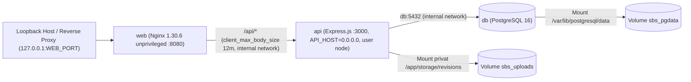

# Panduan Deployment & Operasional Kontainer — Sistem Bimbingan Skripsi (Kelompok A4)

> **Status:** Fondasi containerization (`client/Dockerfile`, `server/Dockerfile`, `compose.yaml`, dan `compose.dev.yaml`) tersedia pada `SBS-04`. Integrasi domain publik `sbs.kxrumii.my.id`, HTTPS, Cloudflare Tunnel, dan operasional server produksi akan dilengkapi pada `SBS-14` dan `SBS-15`.

---

## 1. Perbandingan Dua Mode Operasional

Proyek memisahkan alur **Development Lokal (Mode A)** dan **Compose Full Stack (Mode B)** agar pengembangan di host tetap praktis tanpa mengurangi isolasi jaringan dan port pada stack utama.

### Mode A — Development Lokal (`compose.yaml` + `compose.dev.yaml`)

- **Database (`db`):** Dijalankan dalam container menggunakan project terpisah `sbs-dev` melalui `npm run dev:db:up` (`docker compose -p sbs-dev -f compose.yaml -f compose.dev.yaml up -d db`). Override `compose.dev.yaml` menambahkan port binding khusus `127.0.0.1:5432:5432` pada bridge `dev_local`.
- **Backend (`api`):** Berjalan langsung di host melalui `npm run dev:server` (atau `npm run dev`), mendengarkan pada **`API_HOST=127.0.0.1`** dan `API_PORT=3000`.
- **Frontend (`client`):** Berjalan di host melalui Vite (`http://127.0.0.1:5173`) dan mem-proxy `/api/*` ke `http://127.0.0.1:3000`.
- **Koneksi DB:** `DATABASE_URL` pada `.env` memakai host **`127.0.0.1:5432`**.

### Mode B — Compose Full Stack (`compose.yaml` saja)

> **Penting:** Jangan menyertakan `compose.dev.yaml` saat menjalankan stack penuh atau lingkungan server.

- **Seluruh Service (`web`, `api`, `db`):** Berjalan sebagai container terorkestrasi oleh `compose.yaml`.
- **Database (`db`):** `postgres:16-alpine` hanya berada pada jaringan `internal` (`internal: true`) **tanpa publikasi port ke host**.
- **Backend (`api`):** Node.js 22 non-root (`uid=1000(node)`), di-override eksplisit dengan **`API_HOST=0.0.0.0`** di dalam jaringan `internal`, tanpa port host. Terhubung ke PostgreSQL menggunakan hostname internal **`db:5432`**.
- **Frontend (`web`):** `nginxinc/nginx-unprivileged:1.30.6-alpine` (`uid=101(nginx)`), menyajikan hasil build SPA, menyediakan `/healthz`, dan mem-proxy `/api/` menuju `http://api:${API_PORT}` dengan batas body `client_max_body_size 12m;`. Hanya `web` yang di-bind ke loopback host (`${WEB_BIND_ADDRESS:-127.0.0.1}:${WEB_PORT:-8080}:8080`).



| Service | Image / Build | Jaringan | Port Host (Mode B) | Volume Persisten |
|---|---|---|---|---|
| `web` | `client/Dockerfile` (`nginxinc/nginx-unprivileged:1.30.6-alpine`) | `frontend`, `internal` | `${WEB_BIND_ADDRESS:-127.0.0.1}:${WEB_PORT:-8080}:8080` | — |
| `api` | `server/Dockerfile` (`node:22-slim`, user `node`) | `internal` | Tidak dibuka | `sbs_uploads` -> `/app/storage/revisions` |
| `db` | `postgres:16-alpine` | `internal` | Tidak dibuka | `sbs_pgdata` -> `/var/lib/postgresql/data` |

> **Catatan keamanan:** Detail operasional server privat (hostname internal, IP privat, username, atau credential) tidak dicantumkan di repository sesuai ADR-012.

---

## 2. Persiapan Environment (`.env`)

1. Salin template environment di root repository:
   ```bash
   cp .env.example .env
   ```
2. Hasilkan password acak URL-safe (hex) untuk database:
   ```bash
   openssl rand -hex 32
   ```
3. Isi `.env`:
   - `POSTGRES_DB` & `POSTGRES_USER`: gunakan huruf kecil, angka, atau underscore (`[a-z0-9_]+`).
   - `POSTGRES_PASSWORD`: isi dengan hasil `openssl rand -hex 32`.
   - `DATABASE_URL`: untuk Mode A, gunakan password yang sama persis dengan format `postgresql://<POSTGRES_USER>:<POSTGRES_PASSWORD>@127.0.0.1:5432/<POSTGRES_DB>?schema=public`. (Pada Mode B, `compose.yaml` membentuk URL ke `@db:5432` secara otomatis.)
   - `API_HOST`: pertahankan `127.0.0.1` di `.env` untuk Mode A. (Pada Mode B, `compose.yaml` otomatis meng-override menjadi `0.0.0.0` di dalam jaringan internal container.)
   - `WEB_BIND_ADDRESS`: pertahankan `127.0.0.1`.
   - `CLIENT_ORIGIN`: `http://localhost:5173` untuk Mode A, atau `http://127.0.0.1:8080` (atau origin HTTPS domain target) untuk Mode B.
4. Pastikan `.env` tidak dilacak Git (`git status --short`) dan tetap masuk `.dockerignore`.
5. Repository menggunakan satu file `.env` di root saja (**jangan** membuat `server/.env`); `server/prisma7.config.ts` memuat root `.env` secara eksplisit dengan `override: false`, sehingga variabel environment proses/CI tetap diprioritaskan di atas `.env` lokal.

---

## 3. Command Operasional Harian

### Mode A — Database Development

```bash
npm run dev:db:up
npm run dev
# Hentikan database development tanpa menghapus volume:
npm run dev:db:down
```

### Mode B — Compose Full Stack

1. Validasi konfigurasi dan build image:
   ```bash
   docker compose config --quiet
   docker compose build
   ```
2. Jalankan seluruh service dan pantau hingga `healthy`:
   ```bash
   docker compose up -d
   docker compose ps
   ```
3. Lihat log dan restart service:
   ```bash
   docker compose logs --tail=100
   docker compose logs -f api
   docker compose restart api
   ```
4. Hentikan stack tanpa menghapus volume data:
   ```bash
   docker compose stop
   # atau:
   docker compose down
   ```

> **Larangan mutlak:** Jangan menjalankan `docker compose down -v` atau `docker volume prune` pada lingkungan yang menyimpan data karena `-v` menghapus named volume `sbs_pgdata` dan `sbs_uploads`.

---

## 4. Pemeriksaan Healthcheck & Endpoint

- **Nginx web container (`web`):** `curl -fsS http://127.0.0.1:8080/healthz` -> `ok`
- **Frontend SPA (`web`):** `curl -I http://127.0.0.1:8080/` -> `HTTP/1.1 200 OK`
- **API health via reverse proxy:** `curl -fsS http://127.0.0.1:8080/api/v1/health` -> JSON `success: true`, `data.status: "ok"`, `data.service: "sbs-api"` tanpa membocorkan credential atau konfigurasi internal.

---

## 5. Persistensi Volume & Integrasi Proxy Eksternal

- **`sbs_pgdata`:** Menyimpan data PostgreSQL 16 pada `/var/lib/postgresql/data` dan bertahan saat container di-restart atau di-recreate.
- **`sbs_uploads`:** Dipasang khusus pada container `api` di `/app/storage/revisions` (user `node`). Tidak terpasang ke `web` dan tidak disajikan sebagai static file publik. Batas `client_max_body_size 12m;` pada `location /api/` di Nginx memberi ruang multipart overhead untuk batas bisnis 10 MiB (`10.485.760` byte) yang akan divalidasi backend di `SBS-09`.
- **Integrasi `SBS-14` & `SBS-15`:** Reverse proxy utama dan/atau Cloudflare Tunnel pada server produksi cukup meneruskan trafik HTTPS `https://sbs.kxrumii.my.id` ke listener loopback `127.0.0.1:${WEB_PORT}`, dengan `CLIENT_ORIGIN=https://sbs.kxrumii.my.id`.

---

## 6. Troubleshooting Singkat

- **Backend lokal gagal terhubung ke database:** Pastikan `npm run dev:db:up` sudah dijalankan dan `DATABASE_URL` pada `.env` menggunakan host `127.0.0.1:5432` dengan password hex URL-safe yang identik dengan `POSTGRES_PASSWORD`.
- **Error validasi environment saat startup `api`:** Periksa `docker compose logs api`. Pastikan `DATABASE_URL` menggunakan skema `postgres://`/`postgresql://`, `API_HOST` berupa IP/hostname valid tanpa skema URL, dan `CLIENT_ORIGIN` berupa URL `http(s)` tanpa wildcard `*`.
- **Port `5432` atau `8080` sudah dipakai di host:** Pastikan instance database atau service lain di host tidak memakai port tersebut; untuk `web`, ubah `WEB_PORT` di `.env` (misalnya `8081`).
