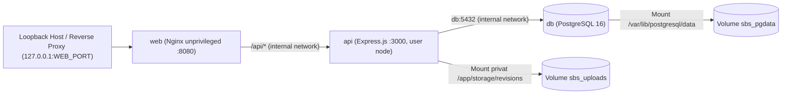

# Panduan Deployment & Operasional Kontainer — Sistem Bimbingan Skripsi (Kelompok A4)

> **Status:** Fondasi containerization (`client/Dockerfile`, `server/Dockerfile`, dan `compose.yaml`) telah tersedia pada `SBS-04`. Integrasi domain publik, HTTPS, Cloudflare Tunnel, dan operasional server produksi akan dilengkapi pada `SBS-14` dan `SBS-15`.

---

## 1. Arsitektur Kontainer

Orkestrasi `compose.yaml` menjalankan tiga service dengan pemisahan jaringan dan penyimpanan berikut:



| Service | Image / Build | Jaringan | Port Host | Volume Persisten |
|---|---|---|---|---|
| `web` | `client/Dockerfile` (`nginxinc/nginx-unprivileged:1.27-alpine`) | `frontend`, `internal` | `${WEB_BIND_ADDRESS:-127.0.0.1}:${WEB_PORT:-8080}:8080` | — |
| `api` | `server/Dockerfile` (`node:22-slim`, non-root `node`) | `internal` | Tidak dibuka | `sbs_uploads` -> `/app/storage/revisions` |
| `db` | `postgres:16-alpine` | `internal` | Tidak dibuka | `sbs_pgdata` -> `/var/lib/postgresql/data` |

> **Catatan keamanan:**
> - Jaringan `internal` dikonfigurasi dengan `internal: true` sehingga `db` dan `api` tidak memiliki akses langsung keluar dan tidak diekspos ke host atau internet.
> - `sbs_uploads` hanya dipasang pada `api`; Nginx pada `web` tidak melayani direktori upload sebagai static path.
> - Detail operasional server privat (hostname internal, IP privat, username, atau credential) tidak dicantumkan di repository sesuai aturan proyek.

---

## 2. Persiapan Environment (`.env`)

1. Salin template environment di root repository:
   ```bash
   cp .env.example .env
   ```
2. Isi variabel wajib pada `.env` menggunakan nilai aman (jangan membiarkan placeholder `CHANGE_ME_*`):
   - `POSTGRES_DB`: nama database (contoh `sbs_dev`)
   - `POSTGRES_USER`: nama pengguna PostgreSQL (non-default yang aman)
   - `POSTGRES_PASSWORD`: password PostgreSQL yang kuat
   - `DATABASE_URL`: untuk penggunaan lokal non-Docker (`@localhost:5432`). Di dalam `compose.yaml`, `api` otomatis membentuk `DATABASE_URL` menggunakan host internal `@db:5432`.
   - `WEB_BIND_ADDRESS`: pertahankan `127.0.0.1` agar `web` tidak terbuka langsung ke semua interface jaringan.
   - `WEB_PORT`: port host loopback (default `8080`).
   - `API_PORT`: port internal service `api` (default `3000`).
   - `CLIENT_ORIGIN`: atur ke `http://127.0.0.1:8080` saat mengakses stack Docker Compose dari host lokal, atau origin HTTPS publik pada fase deployment.
   - `UPLOAD_DIR`: digunakan saat menjalankan server secara lokal di luar container (`./storage/revisions`). Di dalam `compose.yaml`, `api` menggunakan `/app/storage/revisions`.
3. Pastikan `.env` tidak dilacak Git (`git status --short` tidak menampilkannya) dan tetap dikecualikan oleh `.dockerignore`.

---

## 3. Build dan Start Container

Jalankan seluruh perintah dari root repository:

1. Validasi sintaks `compose.yaml` dan substitusi variabel `.env`:
   ```bash
   docker compose config --quiet
   ```
2. Build image `web` dan `api`:
   ```bash
   docker compose build
   ```
3. Jalankan seluruh service di background:
   ```bash
   docker compose up -d
   ```
4. Pantau status container dan healthcheck:
   ```bash
   docker compose ps
   ```
   Tunggu hingga kolom status `db`, `api`, dan `web` sama-sama menunjukkan `healthy`.

---

## 4. Pemeriksaan Healthcheck & Endpoint

- **Nginx web container:**
  ```bash
  curl -fsS http://127.0.0.1:8080/healthz
  ```
  Respons yang diharapkan: `ok`.
- **Frontend SPA:**
  ```bash
  curl -I http://127.0.0.1:8080/
  ```
- **API health check melalui reverse proxy `web`:**
  ```bash
  curl -fsS http://127.0.0.1:8080/api/v1/health
  ```
  Respons yang diharapkan: HTTP `200` JSON berisi `success: true`, `data.status: "ok"`, dan `data.service: "sbs-api"` tanpa membocorkan konfigurasi atau credential.

---

## 5. Logs, Restart, dan Stop

- Melihat log seluruh service atau service tertentu:
  ```bash
  docker compose logs --tail=100
  docker compose logs -f api
  ```
- Merestart salah satu service:
  ```bash
  docker compose restart api
  ```
- Menghentikan container tanpa menghapus data volume:
  ```bash
  docker compose stop
  # atau melepas container & network sambil tetap mempertahankan volume:
  docker compose down
  ```
- **Larangan:** Jangan menjalankan `docker compose down -v` atau `docker volume prune` pada stack yang menyimpan data aktif karena dapat menghapus `sbs_pgdata` dan `sbs_uploads`.

---

## 6. Persistensi Database dan Upload

- **`sbs_pgdata`:** Menyimpan seluruh data PostgreSQL 16 di `/var/lib/postgresql/data`. Data tetap bertahan saat container `db` di-restart atau di-recreate (`docker compose up -d --force-recreate`).
- **`sbs_uploads`:** Dipasang khusus pada container `api` di `/app/storage/revisions` (dimiliki user non-root `node`). Direktori ini disiapkan untuk modul upload berkas revisi (`SBS-09`) dengan kontrol otorisasi backend dan tidak pernah dipetakan ke container `web`.
- Prosedur backup terjadwal dan uji restore terjadwal akan didokumentasikan pada `SBS-15`.

---

## 7. Catatan Integrasi Reverse Proxy Eksternal (`SBS-14`)

Saat stack dideploy pada lingkungan server produksi:
- Biarkan `web` tetap hanya mengikat ke loopback (`127.0.0.1:${WEB_PORT}`) atau jaringan reverse proxy internal.
- Reverse proxy utama server dan/atau Cloudflare Tunnel meneruskan trafik HTTPS publik untuk `https://sbs.kxrumii.my.id` menuju listener loopback service `web`.
- Atur `CLIENT_ORIGIN=https://sbs.kxrumii.my.id` pada environment runtime server agar kebijakan CORS dan validasi origin (pada modul auth berikutnya) selaras dengan domain publik.

---

## 8. Troubleshooting Singkat

- **Error validasi environment saat startup `api`:** Periksa `docker compose logs api`. Jika muncul pesan variabel wajib tidak valid, pastikan `DATABASE_URL` valid dan `CLIENT_ORIGIN` berupa URL `http://` atau `https://` eksplisit tanpa wildcard `*`.
- **`web` gagal mem-proxy `/api/`:** Pastikan service `api` dalam status `healthy` dan `API_PORT` pada environment `web` sama dengan `API_PORT` pada service `api`.
- **Port `8080` sudah terpakai di host:** Ubah `WEB_PORT` pada `.env` (misalnya `8081`) lalu jalankan ulang `docker compose up -d`.
