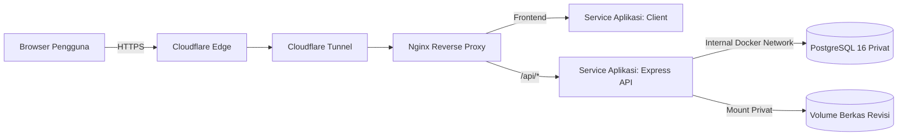

# Panduan Deployment — Sistem Bimbingan Skripsi (Kelompok A4)

> **Status:** Kerangka arsitektur target. Deployment belum dilakukan; `Dockerfile`, `compose.yaml`, konfigurasi Nginx, dan Cloudflare Tunnel belum dibuat pada tahap ini.

---

## 1. Status Deployment Saat Ini

- **Lingkungan target:** Server Linux dengan Docker Engine dan Docker Compose.
- **Domain target:** `https://sbs.kxrumii.my.id`
- **Status aktual:** Belum dikonfigurasi, belum di-build, dan belum di-deploy.

## 2. Arsitektur Target

Komponen yang direncanakan untuk menjalankan sistem:

- **Container runtime & orchestration:** Docker Engine dan Docker Compose untuk mengorkestrasi service aplikasi (`web` / frontend, `api` / backend) serta database.
- **Database:** PostgreSQL 16 pada **internal Docker network** yang tidak diekspos langsung ke internet.
- **Reverse proxy:** Nginx untuk meneruskan trafik ke frontend maupun endpoint `/api/*` backend.
- **Public ingress & HTTPS:** Cloudflare Tunnel sebagai jalur akses publik menuju domain `sbs.kxrumii.my.id` dengan terminasi HTTPS valid.

> **Catatan keamanan:** Detail operasional internal server (nomor port internal host, direktori host, alamat IP privat, username, konfigurasi akses administratif, maupun credential) tidak dicantumkan di repository dan baru didokumentasikan seperlunya setelah konfigurasi aktual diverifikasi.

## 3. Pemisahan Trafik Publik, Service Aplikasi, dan Database Privat

Topologi target memisahkan jalur akses ke dalam tiga zona agar service internal dan basis data tidak terbuka langsung ke internet:

1. **Zona Trafik Publik (Ingress):** Permintaan pengguna ke `https://sbs.kxrumii.my.id` masuk melalui HTTPS, melewati Cloudflare Edge dan Cloudflare Tunnel menuju Nginx reverse proxy tanpa membuka port database maupun container internal ke publik.
2. **Zona Service Aplikasi:** Nginx meneruskan permintaan antarmuka ke service frontend (`client`/`web`) dan permintaan API (`/api/*`) ke service backend (`server`/`api`). Service backend menegakkan autentikasi, otorisasi, serta mengatur akses ke volume berkas revisi privat sehingga berkas tidak pernah disajikan sebagai static public path.
3. **Zona Database Privat:** PostgreSQL 16 hanya berjalan pada internal Docker network dan diakses oleh service backend (`api`) tanpa port publik ke jaringan luar.

## 4. Prasyarat & Konfigurasi Environment

- Variabel environment mengacu pada [`.env.example`](../.env.example).
- File `.env` aktual dan secrets tidak disimpan atau di-commit ke repository Git.
- Konfigurasi runtime produksi serta secrets dikelola langsung pada lingkungan server di luar repository publik.

## 5. Build & Start Container

Bagian ini akan dilengkapi setelah `Dockerfile` dan `compose.yaml` dibuat pada tahap containerization.

Perintah operasional Docker yang akan didokumentasikan sesuai konfigurasi final:
- `docker build`
- `docker ps`
- `docker images`
- `docker logs`
- `docker exec`
- `docker compose up -d`
- `docker compose down`
- `docker compose ps`
- `docker compose logs`
- `docker stats`

## 6. Persistensi Volume & Backup

Bagian ini akan dilengkapi setelah volume persisten dan prosedur backup/restore diimplementasikan:
- Named volume persisten terpisah untuk data PostgreSQL 16.
- Volume privat terpisah untuk berkas revisi (PDF/DOCX, maksimal 10 MiB / `10.485.760` byte per file) yang hanya dapat diunduh melalui endpoint terotorisasi.
- Prosedur backup dan uji pemulihan (*restore*) untuk database dan berkas revisi.

## 7. Verifikasi Publik & Troubleshooting

Bagian ini akan diisi setelah deployment aktual berjalan, mencakup bukti verifikasi HTTPS pada `https://sbs.kxrumii.my.id`, pemeriksaan kesehatan container/logs, verifikasi isolasi database dari jaringan publik, serta langkah troubleshooting.
